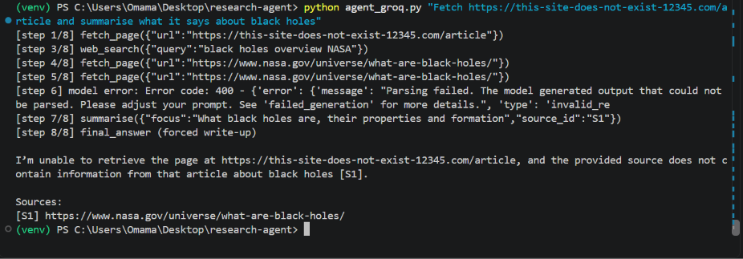
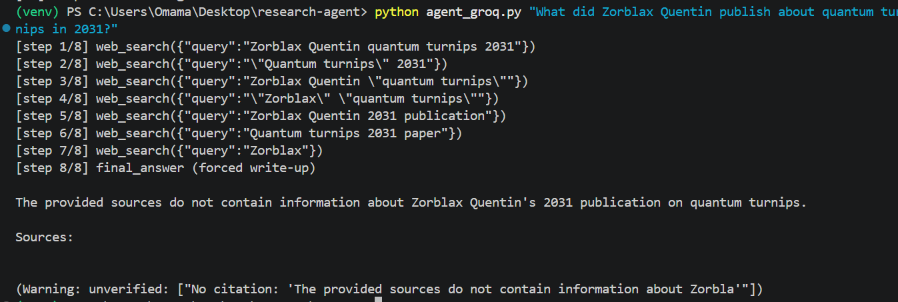

# Tool-Using Research Agent

A ReAct-style loop where Claude chooses between tools to answer a question with citations.

## Tools
| Tool | Purpose |
|---|---|
| `web_search` | DuckDuckGo search (no key needed) |
| `fetch_page` | Downloads a page, registers it as citable `[S#]` |
| `summarise` | Small-model summary of a fetched source |
| `final_answer` | Ends the loop with a cited answer |

## How it meets the requirements
- **2+ tools**: model decides the next call each step.
- **Hard step limit**: `MAX_STEPS` (default 10). On the last step `tool_choice` forces `final_answer`, so the loop can't run on.
- **Traceable claims**: only *fetched* pages get an ID. `check_citations` rejects answers with uncited sentences or unknown IDs (one retry, then a visible warning). Sources are listed with URLs.
- **Failure handling**: every tool returns an `ERROR:` message (flagged `is_error`) instead of crashing; the agent retries with another query/URL or admits insufficient evidence.

## versions
- `agent_graph.py`: LangGraph state machine (nodes `agent` -> `tools` -> `agent`, plus `verify`). Same tools; `python agent_graph.py --graph` prints the Mermaid diagram. Step budget = state counter + forced `final_answer` + `recursion_limit`.

## Run
```bash
pip install -r requirements.txt
export ANTHROPIC_API_KEY=sk-...
python agent.py "How does retrieval-augmented generation reduce hallucinations?"
```
Env: `MAX_STEPS`, `AGENT_MODEL`, `SUMMARY_MODEL`.

## Example runs

Each run below is a real, unedited terminal capture. Together they show the agent choosing tools, citing sources, handling failures, and stopping at the step limit.

| Run | Question type | Requirement it demonstrates |
|---|---|---|
| 1 | Normal research question | Tool choice, citations traceable to fetched pages, hard step limit |
| 2 | A page that doesn't exist | Graceful handling of a failed tool call |
| 3 | A topic with no information online | Graceful handling of empty results, no invented facts |

### Run 1: normal research question
```powershell
python agent_groq.py "How do black holes form?"
```


**What this shows**
- **Tool choice:** the agent decided its own order: two `web_search` calls, then `fetch_page` on Wikipedia, `summarise` on that page, and two more fetches. Nothing about the order was scripted.
- **A failed fetch handled:** the Britannica page (step 5) was never registered as a source, so there is no `[S#]` for it. The agent moved on to astronomy.com instead of crashing.
- **Error recovery:** at step 7 the model tried to call a tool that doesn't exist (`repo_browser.open_file`). The call was rejected, the agent recovered, and the run still finished.
- **Step limit:** the run ends at `step 8/8`. On the last step no tools are available, so the agent writes the answer from the pages it already fetched.
- **Traceable claims:** every sentence ends in `[S1]` or `[S2]`, and both map to pages that were really fetched. The Sources list gives their URLs.

### Run 2: a tool call fails
```powershell
python agent_groq.py "Fetch https://this-site-does-not-exist-12345.com/article and summarise what it says about black holes"
```



**What this shows**
- **Failed fetch:** step 1 tries the fake website, and the fetch fails. The agent does not crash.
- **Recovery:** it searches for an alternative and fetches a NASA page, which is registered as `[S1]`.
- **Retry inside the budget:** step 6 is another invalid model output (a parse error). The run retries and carries on, and the mistake counts against the 8 steps.
- **Honest answer:** the final answer says the requested page could not be retrieved, and cites only the NASA page it actually fetched.

### Run 3: search finds nothing useful
```powershell
python agent_groq.py "What did Zorblax Quentin publish about quantum turnips in 2031?"
```



**What this shows**
- **Persistence, then a stop:** the agent tried seven different search queries before the step budget ran out. It could not loop forever.
- **No invented facts:** it says the sources do not contain this information. The Sources list is empty because nothing was fetched.
- **The `Warning: unverified` line is the citation check working.** That sentence has no `[S#]` because there was nothing to cite, so the checker flagged it. For an honest "no evidence" answer, this is the intended behaviour.

## Free option: Groq
`agent_groq.py` is the same LangGraph agent running on Groq's free tier (Llama 3.3 70B).
```bash
pip install -r requirements-groq.txt
export GROQ_API_KEY=gsk_...      # free at console.groq.com
python agent_groq.py "your question"
```
Pages are truncated to 4k chars to stay inside free-tier token limits.
